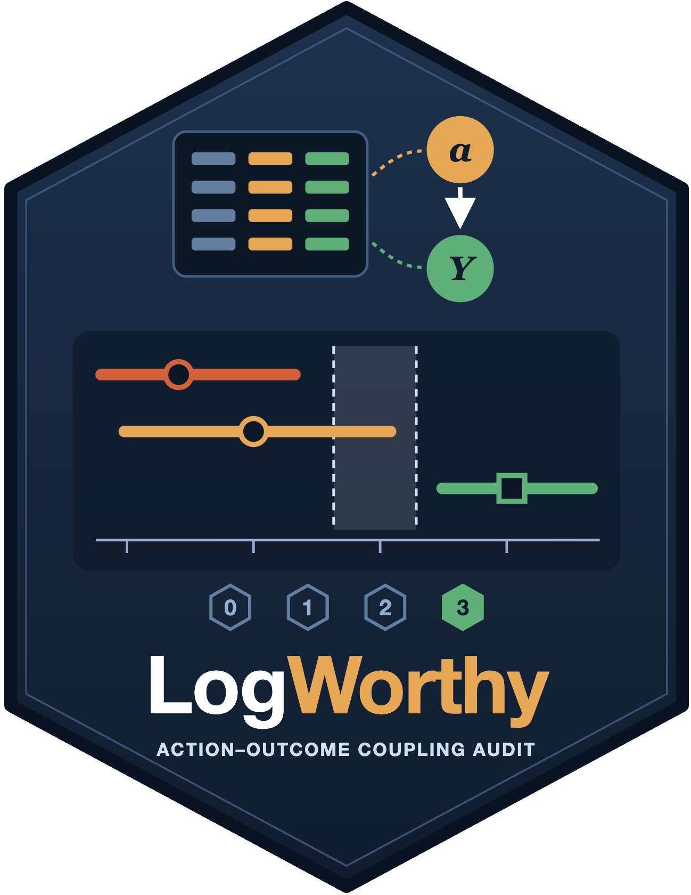

<table border="0">
  <tr>
    <td>
      
    </td>
    <td>
      <h1>LogWorthy</h1>
      <h2>Can your log support a policy? Action–outcome coupling audit for offline reinforcement learning</h2>
      <h3>Tung Dang, The Hung Phung, Son Lam Nguyen, and Tu Nguyen (2026). </h3>
    </td>
  </tr>
</table>


---

## What this answers

Offline RL and OPE start by asking *which policy is best*. LogWorthy asks the
question that comes before it: **does the outcome respond to the action at all,
by enough that this log could detect it?**

Skipping that question is not harmless. A learner run on a decoupled log will
still return a policy, still report an improvement, and still certify it on a
clean honest split — because a greedy argmax over noise selects its own
estimation error. The certificate looks exactly like a real one. LogWorthy
answers with a **tier and a reason code** instead of a number:

| Tier | Name | What the data support |
|---|---|---|
| 0 | Refuse | nothing for this (dataset, reward, reference design, policy class) |
| 1 | Predict | calibrated prediction only; no policy verdict |
| 2 | Shadow | optimisation on the logged distribution; shadow deployment |
| 3 | Deploy | offline policy optimisation within the named policy class |

Reason codes say *why* it stopped — `G` bad target, `I` no overlap, `C`
confounded, `P` below detectability, `L` learner did not certify — and a
trailing `?` means the rule **abstained** rather than decided, which is a
first-class answer reported together with the pilot that would settle it.

## Install

```bash
pip install -e .                 # audit only
pip install -e '.[examples]'     # + pandas, scikit-learn (bundled datasets)
pip install -e '.[rl]'           # + d3rlpy, torch (real CQL)
```

Python ≥ 3.9. The audit core needs only NumPy and SciPy. Editable installs read
`pyproject.toml`, so they need pip ≥ 21.3 (`pip install -U pip` if yours is
older); the scripts in `examples/` also run straight from a clone without
installing anything.

## Use

```python
from logworthy import audit, summary

verdict = audit(
    y=outcomes,          # what you want more of
    actions=actions,     # what was decided
    state=state,         # pre-decision variables only
    clusters=clusters,   # the unit of independence
    weights=weights,     # rho(a) / pi_b(a|s)
)
print(verdict.label)     # e.g. '0 (P?)'
print(summary(verdict))  # the numbers behind it
```

`clusters` is the argument that matters most. Precision is set by independent
clusters, not rows: a log of 100,000 orders across 27 states carries the
information of a few thousand. Every interval here is computed by resampling
clusters, never rows.

To certify a learner as part of the audit:

```python
from logworthy import audit, ConservativeQ

verdict = audit(..., learner=ConservativeQ(), propensities=pi_b, n_seeds=30)
```

## What it does

**Coupling, honestly measured.** Bias-corrected partial ω² for the action
block, with a restricted wild cluster bootstrap. A negative estimate is kept,
not clipped: it is evidence *for* the null.

**A threshold from the same test.** `calibrate_threshold` injects a rescaled
copy of the fitted action block into null data and finds the smallest coupling
the audit's own bootstrap detects at 80% power, so interval and threshold rest
on one footing. Verdicts compare the coupling interval against the threshold
*band*, so nothing is decided inside the threshold's own uncertainty.

**A causal diagnostic that refuses to overreach.** The saturation ladder
declares confounding only when the coupling declines **and** the enrichment
covariates significantly predict the action. A decline alone is as consistent
with variance absorption, and the second condition must be a one-sided test,
not a point estimate.

**RL that is audited, not assumed.** `logworthy.rl` carries the learners
(`ConservativeQ`, `GreedyDR`, `GradientBoostedQ`, and `DiscreteCQL` wrapping
d3rlpy), the doubly robust estimator, and the certification protocol: disjoint
folds, many seeds, a permutation null. Two rules are enforced rather than left
to the user:

- the **influence function carries its baseline per row**, so the standard
  error is computed from the right quantity;
- for contextual policies the certified quantity is the **paired uplift over
  the best fixed rule**, since the fixed-rule class sits inside the contextual
  one and beating the logging policy proves nothing.

**A certificate is not a licence.** When a learner certifies on a coupling the
design cannot resolve, the audit reports the certificate as unsupported and
routes the log by its detectability branch.

**Sequential objectives.** `run_c6` runs fitted-Q evaluation and splits the
coupling into immediate and downstream parts (Proposition 1). C6 is decided on
`D_cont`, never on the sequential share `chi_seq`, which can be negative while
downstream responsiveness is strictly positive.

## Examples

```bash
python examples/quickstart.py
```

Runs the audit end to end on the two public logistics logs from the paper,
bundled here as column extracts (no download, no modified values — see
`examples/data/prepare_data.py`). It walks through a reward that cannot be
audited at all, a real question refused for power, the increment rule, and the
ladder.

## Layout

```
logworthy/
  core/       coupling estimator, cluster bootstrap, detectability threshold
  audit/      feasibility gates, saturation ladder, the audit runner
  verdict/    tiers, reason codes, the routing rule
  rl/         learners, DR estimators, certification, sequential C6
  report/     readable summaries
  datasets.py the two bundled logs
```

Run the tests with `pytest`.

## Citation

```bibtex
@article{dang2026logworthy,
  title   = {Can your log support a policy? Action--outcome coupling audit
             for offline reinforcement learning},
  author  = {Dang, Tung and Phung, The Hung and Nguyen, Son Lam and Nguyen, Tu},
  journal = {},
  year    = {2026},
  doi     = {}
}
```

MIT licensed. The bundled extracts keep their original licences: Olist
CC BY-NC-SA 4.0, DataCo CC BY 4.0.
