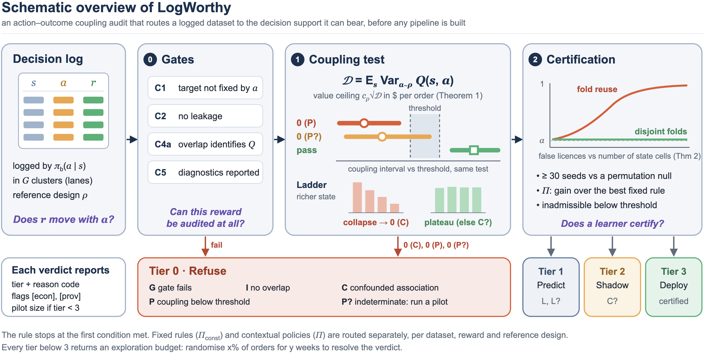

<table border="0">
  <tr>
    <td>
      
    </td>
    <td>
      <h1>LogWorthy — Can your log support a policy? Action–outcome coupling audit for offline RL</h1>
      <h3>Tung Dang, The Hung Phung, Son Lam Nguyen, and Tu Nguyen (2026). arXiv preprint. https://doi.org/10.48550/arXiv.2607.11269 </h3>
    </td>
  </tr>
</table>

